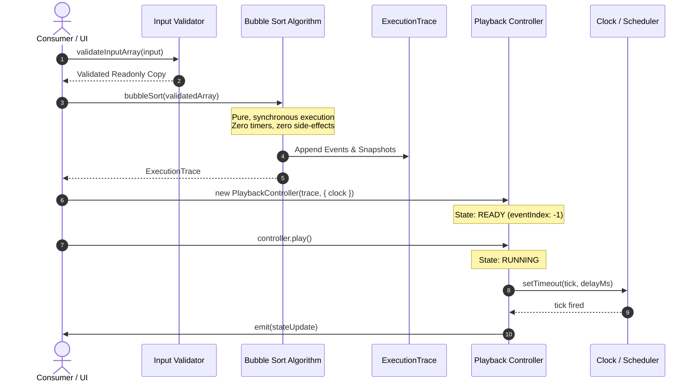
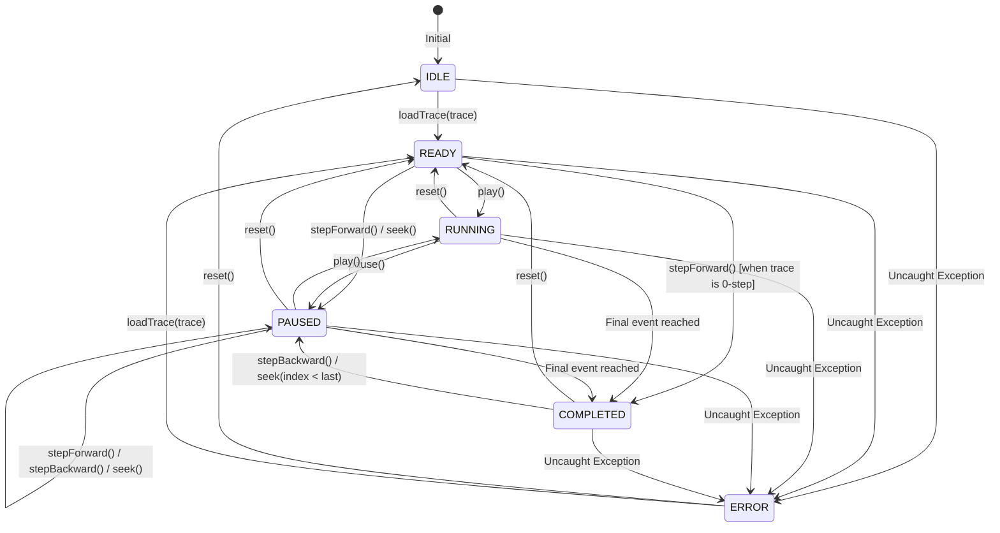

# Virtual CSE Lab — Simulation Engine Architecture

## Document Overview
- **Project:** Virtual CSE Laboratory — Educational Simulation Engine
- **Milestone:** Milestone 2A — Event-to-Code Mapping & Selection Sort
- **Document Path:** [Simulation Engine/docs/ARCHITECTURE.md](file:///c:/Users/vansh/OneDrive/Desktop/Piyush%20AI/Labs/Simulation%20Engine/docs/ARCHITECTURE.md)
- **Status:** Complete & Approved
- **Date:** October 21, 2026

---

## 1. Architectural Philosophy

The Virtual CSE Lab simulation engine is designed under five fundamental principles:

1. **Absolute Determinism:** Given the same input, an algorithm must always emit the exact same sequence of events.
2. **Strict Decoupling of Math and Time:** Algorithm execution produces pure mathematical event traces synchronously without timers or animation frames. Playback consumes traces asynchronously.
3. **Deep Immutability:** Event objects, snapshots, code mappings, and caller inputs are frozen. Accidental mutation is impossible.
4. **Bidirectional Temporal Navigation:** State reconstruction allows moving forward, backward, or seeking to any arbitrary point in time with $O(1)$ snapshot access.
5. **Zero External Dependencies:** Built with pure standard JavaScript ES modules, executable both in Node.js and modern web browsers without polyfills or compilation.

---

## 2. System Architecture & Module Boundaries

The simulation engine is organized into three distinct layers:

```
┌────────────────────────────────────────────────────────────────────────┐
│                              PUBLIC API                                │
│                          (src/index.js)                                │
└──────────────────┬─────────────────────────────────┬───────────────────┘
                   │                                 │
                   ▼                                 ▼
┌──────────────────────────────────────┐  ┌──────────────────────────────┐
│           ALGORITHM LAYER            │  │        PLAYBACK LAYER        │
│    (src/algorithms/bubbleSort.js     │  │  (src/playback/controller.js │
│     src/algorithms/selectionSort.js) │  │   src/playback/clock.js      │
│                                      │  │   src/playback/stateMachine) │
│  - Pure function implementations     │  │                              │
│  - Discrete educational event streams│  │  - Headless state machine    │
│  - Event-to-code line mappings       │  │  - Injectable clock scheduler│
│  - Comparisons, swaps, candidates    │  │  - Subscriber notification   │
└──────────────────┬───────────────────┘  │  - Scrubbing, step & seek    │
                   │                      └──────────────┬───────────────┘
                   ▼                                     │
┌────────────────────────────────────────────────────────┴───────────────┐
│                              CORE LAYER                                │
│                       (src/core/validator.js                           │
│                        src/core/trace.js                               │
│                        src/core/types.js                               │
│                        src/core/errors.js                              │
│                        src/core/freeze.js)                             │
│                                                                        │
│  - Strict input & codeMapping schema validation checks                 │
│  - ExecutionTrace container & dual algorithm validation logic          │
│  - Strongly-typed ErrorCode definitions & EngineError hierarchy        │
│  - Deep freezing & event integrity validation                          │
└────────────────────────────────────────────────────────────────────────┘
```


---

## 3. Data Flow Diagram



---

## 4. Playback Controller State Machine

The playback controller operates as a deterministic finite state machine (FSM). The states and permitted transitions are shown below:



---

## 5. Module Responsibilities

### 5.1 `src/core/types.js`
- Defines enumerations:
  - `EventType`: `ALGORITHM_START`, `PASS_START`, `COMPARE`, `SWAP`, `NO_SWAP`, `PASS_COMPLETE`, `ALGORITHM_COMPLETE`.
  - `PlaybackState`: `IDLE`, `READY`, `RUNNING`, `PAUSED`, `COMPLETED`, `ERROR`.
  - `ErrorCode`: Domain-specific error codes for predictable error handling.

### 5.2 `src/core/errors.js`
- Defines `EngineError`, encapsulating error codes, context details, and formatted error messages.

### 5.3 `src/core/freeze.js`
- Provides standalone `deepFreeze(obj)` with `WeakSet` visited protection for circular structures and traversal of shallow-frozen parents.
- Shared by both `trace.js` and `validator.js`, eliminating circular dependency risks while enforcing deep immutability across traces, events, and code mappings.

### 5.4 `src/core/validator.js`
- Validates that caller input is a proper array containing only finite numbers within `maxArraySize` (100).
- Validates algorithm configuration options via `validateAlgorithmOptions()` against hard resource ceilings (`HARD_LIMITS`).
- Produces frozen defensive copies of input arrays to protect caller state.
- Resolves algorithm-aware pseudocode boundaries via `resolvePseudocodeBoundary()`: guarantees recognized algorithms (`bubbleSort`, `selectionSort`) are authoritative and cannot be overridden by arbitrary `maxLines`; rejects contradictory configuration.
- Enforces strict code mapping validation via `validateCodeMapping()`, ensuring 1-based indexing, valid line bounds, and recursive deep immutability across `variables` (nested objects and arrays).

### 5.5 `src/core/trace.js`
- Contains `ExecutionTrace`, which holds the immutable event stream, metrics, and snapshots.
- Re-exports `deepFreeze` from `freeze.js` for external backward compatibility.
- Implements `getSnapshotAt(eventIndex)`:
  - Supports index `-1` for the pre-execution initial array.
  - Supports indices `0` through `events.length - 1`.
- Implements `reconstructState(targetIndex)` which applies swap deltas forward to independently verify snapshots.
- Performs exhaustive defensive validation in `validate()`:
  - Verifies event IDs, step numbers, descriptions, types, and required payload fields.
  - Validates full semantic correctness of every payload: `ALGORITHM_START.payload.array` and `totalElements`, `PASS_START` pass and bound, `COMPARE` strict index adjacency, current values, and numerical `shouldSwap`, `SWAP`/`NO_SWAP` agreement, `PASS_COMPLETE` pass, lockedIndex, and swapsInPass, `ALGORITHM_COMPLETE` sortedArray and accumulated totals.
  - Enforces strict finite integer checks on all indices, steps, and metrics.
  - Validates active indices and monotonic locked indices.
  - Verifies non-decreasing metrics and final metrics consistency.
  - Checks final array sortedness and multiset permutation preservation.
  - Compares every single snapshot against an independent simulation reconstruction.

### 5.6 `src/algorithms/bubbleSort.js`
- Pure, synchronous implementation of the Bubble Sort algorithm.
- Tracks active indices, comparisons, swaps, passes, and locked (sorted) indices.
- Emits structured `codeMapping` linking each event to 1-based Bubble Sort pseudocode.
- Enforces `MAX_EVENTS` limit (50,000) and hard ceilings to prevent runaway execution loops.
- Returns an `ExecutionTrace` encapsulating the entire simulation timeline.

### 5.7 `src/algorithms/selectionSort.js`
- Pure, synchronous implementation of the Selection Sort algorithm.
- Emits educational events representing actual algorithm mechanics: `PASS_START`, `CANDIDATE_SELECT`, `COMPARE`, `CANDIDATE_UPDATE`, `SWAP`, `NO_SWAP`, `PASS_COMPLETE`.
- Distinguishes candidate minimum updates from array swaps; never produces false swaps.
- Emits structured `codeMapping` linking each event to 1-based Selection Sort pseudocode.
- Enforces `MAX_EVENTS` limit and hard ceilings.
- Produces deterministic, validated execution traces.

### 5.8 `src/playback/clock.js`
- Defines the `Clock` interface (`setTimeout`, `clearTimeout`, `now`).
- Implements `RealClock` for production runtime using native timers.
- Implements `VirtualClock` for automated testing, allowing deterministic simulated time advancement without async delays.
- Validates timer callbacks (`typeof callback === 'function'`) and delay intervals as non-negative finite whole milliseconds (`Number.isInteger(delayMs) && delayMs >= 0`). Fractional milliseconds, negative values, `NaN`, and infinities are rejected with `TypeError`.
- Enforces limit checks on `tick(ms)` (rejects negative time with `RangeError`, non-integers with `TypeError`) and `runAll(maxSteps)` (rejects non-positive limits with `RangeError`, non-integers with `TypeError`).

### 5.9 `src/playback/stateMachine.js`
- Validates and performs state transitions for the playback controller.
- Strictly validates initial and reset states to prevent initialization into unknown states.
- Throws an `EngineError` (`INVALID_CONTROLLER_STATE`) if an illegal transition is attempted.

### 5.10 `src/playback/controller.js`
- Reusable, headless playback manager.
- Enforces a trusted trace boundary: candidate traces in `loadTrace(trace)` are fully validated prior to mutating controller state (transactional safety). If candidate trace validation fails, the previous trace, index, state, and timers remain untouched.
- Distinguishes clearly between an **uninitialized controller** (`state === IDLE`, `trace === null`, `isDisposed === false`, which can be initialized via `loadTrace(trace)`) and a **disposed controller** (`isDisposed === true`, which permanently rejects all operations).
- Guarantees zero advancement after pause, reset, trace replacement, or disposal.
- Supports `play()`, `pause()`, `stepForward()`, `stepBackward()`, `seek(index)`, `reset()`, `setSpeed(multiplier)`, `setDelay(ms)`.
- Validates all index parameters as finite integers within valid ranges.
- Enforces re-entrancy safety: protects listener dispatch loops when subscribers call `pause()`, `seek()`, `reset()`, `loadTrace()`, `unsubscribe()`, or `dispose()`.
- Provides tick error resilience: unexpected timer callback exceptions cleanly transition to `PlaybackState.ERROR` and cancel pending timers, never leaving the controller permanently stuck in `RUNNING`.
- Ensures non-overlapping timer execution and clean resource teardown (`dispose()`).

---

## 6. Educational Metadata & Pseudocode Highlighting Design

Educational simulations require more than raw values; learners need contextual explanations at every step. Each event emitted by the algorithm includes:
- `description`: A dynamic narrative describing why the action is occurring (e.g., *"Comparing candidate at index 0 (8) with element at index 1 (3). 3 < 8, new minimum found."*).
- `activeIndices`: Indices that visual renderers should highlight as active in this step.
- `lockedIndices`: Indices that visual renderers should mark as sorted and finalized.
- `metrics`: Cumulative statistics (comparisons count, swaps count, passes count, candidate updates count) updated synchronously at each step.
- `codeMapping`: Standardized contract linking the simulation event to a 1-based pseudocode line, an educational explanation of that line's logic, optional multiple related lines, and an immutable snapshot of runtime variables.

### Frontend Pseudocode Highlighting Flow
```
┌────────────────────────────────────────────────────────┐
│                   Playback State                       │
│  state.currentEvent.codeMapping                        │
│  { line: 5, explanation: "...", variables: { ... } }   │
└───────────────────────────┬────────────────────────────┘
                            │
            ┌───────────────┴───────────────┐
            ▼                               ▼
┌─────────────────────────┐   ┌──────────────────────────┐
│   Pseudocode Viewer     │   │   Educational Banner     │
│  Highlight line 5       │   │  Display explanation &   │
│  in Code Viewer UI      │   │  variable inspector      │
└─────────────────────────┘   └──────────────────────────┘
```

